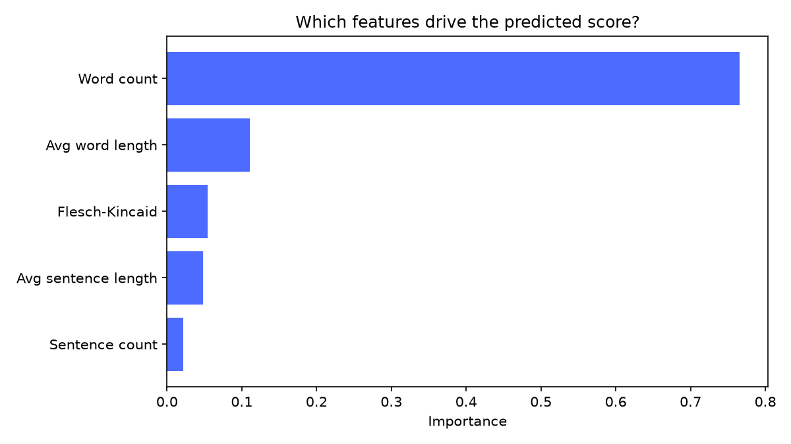

# Automated Essay Grader

A machine-learning system that scores student essays (0-12) and generates feedback, with a desktop interface for students and a batch dashboard for teachers.

## How it works

Raw essay → tokenisation → feature extraction (word count, sentence count, average word length, average sentence length, Flesch-Kincaid readability) → Random Forest regressor → predicted score + banded feedback.

## Results

| Model | MAE | MSE | R² |
|---|---|---|---|
| Linear Regression | — | — | — |
| Random Forest (150 trees, depth 10) | — | — | — |

*(Run 'model_evalutation.py' and 'grid_search.py and paste your real numbers here.)*

## Setup

'''bash
git clone https://github.com/yixlinn/automated-essay-grader.git
cd automated-essay-grader
python -m venv .venv && source .venv/bin/activate # Windows: .venv\Scripts\activate
pip install -r requirements.txt

Download the dataset from Kaggle PERSUADE 2.0 and place train.csv / test.csv in the project root.

python tesing.py # trains the mode, writes model.pkl
python combined.py # launches the app